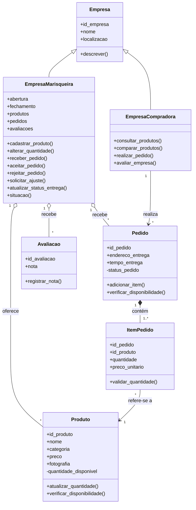
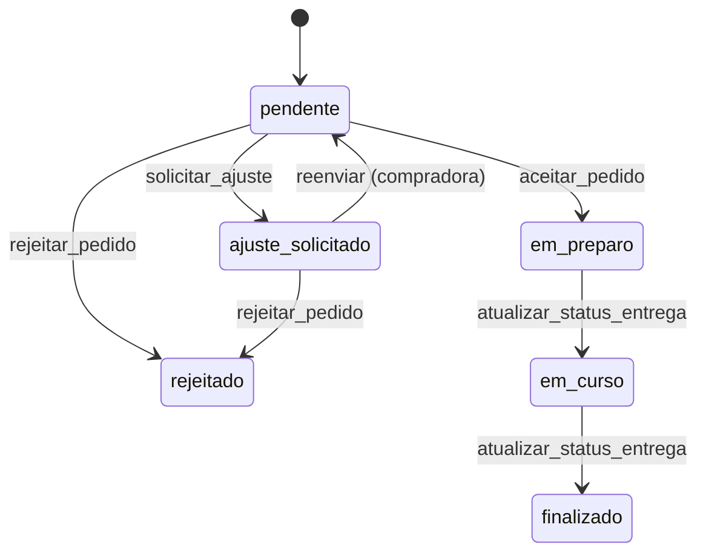

# Modelagem POO — Marisqueiras da Ilha

Documento de modelagem do projeto da disciplina de Programação Orientada a Objetos (docente: Aline Maya).
Base: atividade de 30/09/2026, documento de implementação de 07/10/2026 e documento-base de requisitos (RN01 a RN23).

---

## 1. Visão geral

Sistema **B2B** que apoia a venda direta de mariscos entre **empresas marisqueiras** (fornecem e entregam) e **empresas compradoras**. Não há consumidor final (RN01).

Fluxo comercial (P7): a compradora consulta produtos, monta e envia o pedido; a marisqueira analisa e pode **aceitar**, **rejeitar** ou **pedir ajuste**; depois prepara e entrega; por fim a compradora **avalia** a marisqueira.

Escopo: somente a modelagem e a lógica das classes em memória. Não há banco de dados, tela, pagamento (fora do escopo, RN13) nem rastreamento de entrega em tempo real (RN22).

## 2. Organização do código

| Arquivo | Conteúdo |
|---|---|
| `empresa.py` | `Empresa`, `EmpresaMarisqueira`, `EmpresaCompradora` |
| `produto.py` | `Produto` |
| `pedido.py` | `Pedido`, `ItemPedido` |
| `avaliacao.py` | `Avaliacao` |
| `main.py` | Demonstração do fluxo completo |
| `testes.py` | Testes pelo terminal (blocos "FIGURA 1, 2 e 3" geram os prints do artigo) |
| `simulador.py` | Simulador interativo por perfil (marisqueira / compradora) |

## 3. Classes, atributos e métodos

### 3.1 Empresa (superclasse)
| Atributo | Descrição |
|---|---|
| `id_empresa` | CNPJ |
| `nome` | Nome da empresa |
| `localizacao` | Usada como critério de consulta |

Método: `descrever()` — devolve o perfil em texto. As duas subclasses **sobrescrevem** este método (polimorfismo).

### 3.2 EmpresaMarisqueira (herda de Empresa)
Atributos extras: `abertura`, `fechamento` (horário, em horas), `produtos`, `pedidos`, `avaliacoes`.

| Método | O que faz |
|---|---|
| `cadastrar_produto(produto)` | Cadastra produto próprio; impede repetir nome + categoria |
| `alterar_quantidade(produto, qtd)` | Altera o estoque de um produto próprio (RN08) |
| `receber_pedido(pedido)` | Registra o pedido enviado pela compradora |
| `aceitar_pedido(pedido)` | Revalida o estoque, debita as quantidades e passa o pedido para "em preparo" |
| `rejeitar_pedido(pedido)` | Marca o pedido como rejeitado |
| `solicitar_ajuste(pedido, ajuste)` | Marca "ajuste solicitado" e guarda o texto |
| `atualizar_status_entrega(pedido, status)` | "em curso" e depois "finalizado" (RN22) |
| `situacao(hora)` | Indicador visual: verde, laranja ou vermelho (RN20) |
| `media_avaliacoes()` | Média das estrelas recebidas |

### 3.3 EmpresaCompradora (herda de Empresa)
| Método | O que faz |
|---|---|
| `consultar_produtos(catalogo, ...)` | Filtra por nome, categoria, localização, empresa e avaliação mínima; ordena por menor preço, maior preço, melhor avaliação ou proximidade (RN10, RN11) |
| `comparar_produtos(p1, p2)` | Compara dois produtos, inclusive de empresas diferentes (RN12) |
| `realizar_pedido(pedido, marisqueira)` | Envia o pedido à marisqueira |
| `avaliar_empresa(id, nota, pedido)` | Avalia a marisqueira de 1 a 5 estrelas, após a entrega (RN21) |

### 3.4 Produto
Atributos: `id_produto`, `nome`, `categoria` (fresco ou congelado), `preco`, `fotografia` (opcional), `empresa_origem` e `quantidade_disponivel` (**privado**, em kg).

| Método | O que faz |
|---|---|
| `atualizar_quantidade(qtd)` | Altera o estoque; nunca aceita valor negativo |
| `verificar_disponibilidade(qtd)` | Diz se a quantidade pedida cabe no estoque |
| `baixar_estoque(qtd)` | Debita o estoque quando o pedido é aceito |
| `get_quantidade_disponivel()`, `get_status()` | Leitura do estoque e de "disponível" / "indisponível" (RN09) |

### 3.5 ItemPedido
Atributos: `id_pedido`, `id_produto`, `produto`, `quantidade` (kg) e `preco_unitario` (cópia do preço no momento da compra, RN07).
Método: `validar_quantidade()` — mínimo de 25 kg por produto (RN05, RN15).

### 3.6 Pedido
Atributos: `id_pedido`, `endereco_entrega`, `tempo_entrega`, `empresa_compradora`, `empresa_marisqueira` (definida pelo primeiro item), `itens`, `ajuste_solicitado` e `status_pedido` (**privado**).

| Método | O que faz |
|---|---|
| `adicionar_item(item)` | Valida 25 kg, marisqueira única, produto repetido e estoque (RN14, RN15, RN18) |
| `remover_item(produto)` | Permite à compradora corrigir o pedido |
| `verificar_disponibilidade()` | Reconfere o estoque de todos os itens |
| `reenviar()` | Devolve o pedido ajustado para nova análise |
| `alterar_status(novo)` | Única porta para mudar o status; só aceita transições válidas |
| `total()` | Soma dos itens (não existe valor mínimo, RN16) |

### 3.7 Avaliacao
Atributos: `id_avaliacao`, `nota`.
Método: `registrar_nota()` — aceita somente inteiro de 1 a 5 (RN21).

## 4. Associações

- **Herança:** `EmpresaMarisqueira` e `EmpresaCompradora` herdam de `Empresa`.
- **Composição:** `ItemPedido` só existe dentro de um `Pedido`. (No código o item é criado e depois entregue ao pedido, mas ele não tem sentido fora dele.)
- **Associação / agregação:** a marisqueira possui produtos, pedidos recebidos e avaliações; o item aponta para um produto.

## 5. Pilares de POO no código

| Pilar | Onde aparece |
|---|---|
| **Encapsulamento** | O estoque (`Produto`) e o status (`Pedido`) são privados (`self.__...`). Só mudam por `atualizar_quantidade()`, `baixar_estoque()` e `alterar_status()`, que aplicam as regras. |
| **Herança** | `Empresa` → `EmpresaMarisqueira` e `EmpresaCompradora`, com `super().__init__()`. |
| **Polimorfismo** | `descrever()` é sobrescrito em cada subclasse; o mesmo comando devolve textos diferentes. |
| **Associação e composição** | Seção 4. |
| **Tratamento de exceções** | Toda regra violada faz `raise ValueError("mensagem")`; `main.py`, `simulador.py` e `testes.py` tratam com `try/except`. |

## 6. Estados do pedido

Os três estados do documento (em preparo, em curso, finalizado) são mantidos. Foram acrescentados **pendente**, **ajuste solicitado** e **rejeitado** para representar o fluxo de análise da P7. Não é possível voltar atrás nem pular etapas.

## 7. Decisões de modelagem

1. **O estoque fica em `Produto`** (`quantidade_disponivel`), como no documento de 07/10. A marisqueira só guarda a lista de produtos.
2. **Cadastro exige no mínimo 25 kg** (P19). Depois das vendas o estoque pode ficar abaixo de 25 kg ou chegar a zero; nesse caso o produto continua cadastrado como "indisponível" (RN09, RN19).
3. **O estoque é debitado no aceite**, não quando a compradora monta o pedido. Assim, pedido rejeitado ou ajustado não consome estoque. O aceite reconfere o estoque antes de debitar.
4. **O preço é copiado para o item** (`preco_unitario`), então mudar o preço do produto depois não altera pedidos já montados (RN07).
5. **Uma avaliação por pedido, só com o pedido finalizado.** O documento diz que a cardinalidade das avaliações não é definida; esta foi a escolha adotada.
6. **Estoque baixo = nenhum produto com 25 kg ou mais** (o mínimo de venda). Fora do horário de funcionamento a situação é vermelha. O horário usa horas inteiras (0 a 23), com padrão das 8h às 18h.
7. **Proximidade** (RN11): como não há coordenadas, produtos da mesma localização da compradora aparecem primeiro.
8. **O mesmo produto não pode aparecer duas vezes no pedido**, para que o limite de estoque valha para o total do produto.
9. **O CNPJ é guardado como texto**, sem validar os dígitos verificadores.
10. **RN23 (custo da entrega no preço) é garantida por omissão:** não existe atributo de frete.
11. **RN01, RN02 e RN03** são restrições organizacionais garantidas pela própria estrutura (só existem marisqueira e compradora; uma empresa por habitação; marisqueira individual é uma `EmpresaMarisqueira`).

## 8. Rastreabilidade: regra → método → teste

Os testes ficam em `testes.py`; a coluna "Teste" indica o bloco do arquivo (o início do título impresso no terminal, por exemplo "BUSCA" = bloco "BUSCA, ORDENAÇÃO, COMPARAÇÃO E SITUAÇÃO").

| RN | Regra | Onde está no código | Teste |
|---|---|---|---|
| RN01–RN03 | B2B; 1 habitação = 1 empresa; marisqueira individual | Estrutura das classes | (sem teste: restrição organizacional) |
| RN04 | Venda por kg | `Produto`, `ItemPedido` (quantidades em kg) | PEDIDO E STATUS |
| RN05, RN15 | 25 kg por produto | `ItemPedido.validar_quantidade` | FIGURA 1 |
| RN06 | Fresco e congelado são produtos diferentes | `Produto.__init__`, `cadastrar_produto` | CADASTRO |
| RN07 | Preço fixo na venda | `ItemPedido.preco_unitario` | PREÇO FIXO NA VENDA |
| RN08 | Estoque alterável | `alterar_quantidade`, `atualizar_quantidade` | CADASTRO, REJEIÇÃO E AJUSTE |
| RN09, RN19 | Estoque zero: continua cadastrado, indisponível | `Produto.get_status`, `aceitar_pedido` | FIGURA 2 |
| RN10 | Busca por nome, categoria, localização, empresa, estrelas | `consultar_produtos` | BUSCA |
| RN11 | Ordenação | `consultar_produtos` | BUSCA |
| RN12 | Marisqueira vê só os próprios produtos; compradora compara | `EmpresaMarisqueira.produtos`, `comparar_produtos` | CADASTRO, BUSCA |
| RN13 | Dados obrigatórios do pedido | `Pedido.__init__`, `realizar_pedido` | PEDIDO E STATUS |
| RN14 | Uma marisqueira por pedido | `Pedido.adicionar_item` | FIGURA 2 |
| RN16 | Sem valor mínimo | `Pedido.total` (sem checagem de valor) | PEDIDO E STATUS |
| RN17, RN18 | Limite pelo estoque; bloqueia e informa | `Pedido.adicionar_item`, `aceitar_pedido` | FIGURA 1, REJEIÇÃO E AJUSTE |
| RN20 | Indicador verde / laranja / vermelho | `EmpresaMarisqueira.situacao` | BUSCA, ORDENAÇÃO, COMPARAÇÃO E SITUAÇÃO |
| RN21 | Avaliação de 1 a 5, após a compra | `Avaliacao.registrar_nota`, `avaliar_empresa` | FIGURA 3 |
| RN22 | Entrega pela marisqueira, status sem rastreamento | `atualizar_status_entrega`, `Pedido.alterar_status` | PEDIDO E STATUS |
| RN23 | Custo da entrega no preço | Por omissão (não há campo de frete) | (sem teste) |
